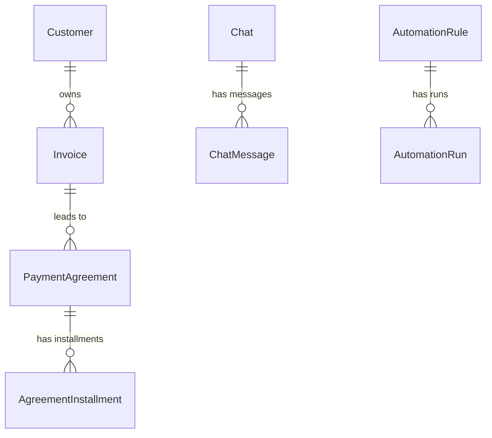
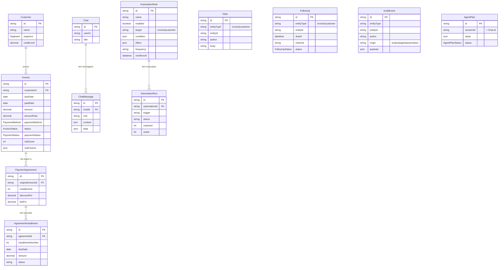

# Expresso Collections

**A B2B collections cockpit with an AI agent that can only act with a human's approval.**

Built solo in five days. Starting from ~8,000 raw, unlabeled invoices, the app scores each one for risk, lets an analyst work the queue (status, notes, payment agreements, follow-ups, all audit-logged), generates PDF reports, runs scheduled automations, and includes a Claude-powered agent that answers questions about the portfolio and proposes actions the analyst confirms.

- **Live app:** https://paggo-case-iota.vercel.app
- **Demo:** click "Logar para a demo" on the login page
- **Português:** [jump to the Portuguese version](#português)

**Stack:** Next.js 16 (App Router, Server Actions) · TypeScript · Tailwind v4 + shadcn/ui · PostgreSQL (Supabase) · Prisma 6 · Claude API (tool use) · @react-pdf/renderer · Recharts · Vitest

## What I built

- **Risk triage.** Every invoice gets a 0–100 score from five additive rules, calibrated against the real distribution of the dataset. The queue sorts by it.
- **Human-in-the-loop AI agent.** A manual tool-use loop over the Claude API. Reads run directly. Any write, even a single note, becomes a pending plan the analyst reviews step by step and confirms. The agent is structurally unable to mutate data.
- **Audit log as a first-class feature.** Every write by the analyst, the agent or an automation emits an audit event in the same database transaction, tagged with its origin.
- **Scheduled automations.** One discriminated `AutomationSpec` (target, condition, effect, schedule) drives the guided form, the agent's tool, validation and the execution engine. Adding a combination is data, not code. Runs on Vercel Cron.
- **Isomorphic PDF reports.** One React PDF document renders in the browser for download or print, and on the server as an email attachment for automations.
- **Payment agreements in integer cents.** Installment schedules never drift; the last installment absorbs rounding.
- **Optimistic UI.** Writes show instantly and persist in the background. Filtering, sorting and search run in memory over the working set.

## Prioritization rules

The data has no priority label. Each invoice gets a **risk score from 0 to 100**, the sum of five additive rules. A higher score means "act first". A score, rather than binary flags, orders a triage queue instead of just marking yes or no.

| Rule | Points | Why |
|---|---|---|
| `balance_at_risk` | 0–30 | Recoverable balance, linear up to R$25k. Recovering money is the direct goal, so it weighs most. |
| `aging` | 0–20 | Days overdue, linear up to 60. The older the debt, the lower the chance of recovery. |
| `chronicity` | 0–20 | The customer's previous late payments, linear up to 5. Repeat lateness signals systemic risk. |
| `ent_first_late` | 15 | An enterprise customer late **for the first time**: high value, usually recoverable, likely an operational slip. |
| `boleto_stuck` | 10 | A BOLETO with more than two attempts: a technical failure, not a lack of money. An easy win by offering PIX. |

A recoverable balance of zero or less zeroes the score, so a paid invoice never enters the queue. Tiers are `critical ≥55`, `high ≥40`, `medium ≥20` and `low ≥1`. The score and its breakdown are persisted per invoice and recomputed on any write that changes an input.

## AI agent

| Tool | Kind | What it does |
|---|---|---|
| `searchInvoices`, `getInvoice`, `getTopRisk` | read | Search, detail and top-N invoices |
| `getPortfolioStats`, `showChart`, `getCustomer`, … | read | KPIs, charts and other portfolio queries |
| `listAutomations` | read | Lists scheduled automations |
| `proposeActions` | **gated** | Proposes a plan (status, note, follow-up, write-off, agreement) for confirmation |
| `proposeAutomation` | **gated** | Proposes a new automation for confirmation |

Every gated call becomes an `AgentPlan(pending)`. The UI shows a modal with each step, removable line by line, and only the analyst's "Confirm" runs `confirmPlan`, in a single transaction. Every agent action lands in the audit log with `origin=agent`.

## Design decisions

- **State on two axes.** `status` is the workflow state machine (`open → in_negotiation → agreement_signed → paid`, with `written_off` and `disputed` as terminal states). `paymentStatus` (`unpaid | partial | paid`) is a separate financial axis, because 13% of invoices have partial payments the workflow doesn't model.
- **A fixed `APP_TODAY`.** The dataset runs from January to May 2026. Using the real clock would push everything into the 90+ days bucket and erase the differences the rules depend on.
- **Client-side filtering.** The working set loads once per scope, so filters, sorting and search respond instantly with no round-trip.
- **Fewer round-trips.** The layout reads the session from the cookie, the chat loads in one call, and Recharts is lazy-loaded.

## Data model



`Note`, `FollowUp` and `AuditEvent` are polymorphic (`entityType` + `entityId`) and point at either an invoice or a customer. The full schema is in `prisma/schema.prisma`.

## Run locally

Requires Node 20+, a Postgres database (Supabase) and an Anthropic API key.

```bash
npm install
npm run db:generate     # Prisma client
npm run db:migrate      # apply the schema
npm run db:seed         # import the CSV and precompute risk (~8,000 invoices)
npm run dev             # http://localhost:3000
```

```bash
DATABASE_URL=                          # Postgres runtime, transaction pooler (pgbouncer=true)
DIRECT_URL=                            # Postgres migrations, session pooler (port 5432)
ANTHROPIC_API_KEY=                     # Claude API key for the agent
APP_TODAY=2026-04-01                   # fixed reference date for aging
NEXT_PUBLIC_SUPABASE_URL=
NEXT_PUBLIC_SUPABASE_PUBLISHABLE_KEY=
CRON_SECRET=                           # optional, protects GET /api/cron/automations
```

The login page has a single demo button that signs in as `demo@expresso.dev` / `demo1234`. Create that user in Supabase (Authentication → Users → Add user, with "Auto confirm" on).

```bash
npm run test:unit       # pure logic, no database, about 1.5 s
npm test                # includes integration tests against the database
```

## Known limitations

- **No customer contact data in the CSV.** A phone follow-up is recorded but triggers nothing real.
- **Email sending is simulated.** The report email effect builds the PDF and logs the run but doesn't call a provider. Swapping `emailReport` for a real provider such as Resend turns it on.
- **Schedules vs. frozen data.** Automations run on the real clock but evaluate conditions against `APP_TODAY`. The demo path is the "Run now" button.

---

## Português

Cockpit de cobrança B2B para um(a) analista triar e agir sobre faturas em atraso.
A partir de ~8.000 faturas cruas (sem rótulo de prioridade), o app deriva prioridade por regras,
deixa o analista atualizar status / notas / acordos / follow-ups com audit log, gera relatórios em
PDF, executa **automações agendadas**, e inclui um **agente de IA** que responde sobre a carteira e
executa ações sob confirmação humana.

- **App publicado:** https://paggo-case-iota.vercel.app
- **Demo:** clique em "Logar para a demo" na tela de login

### O que tem

- **Triagem por risco** — score 0–100 por fatura (5 regras aditivas), tiers e fila ordenada.
- **CRUD + audit** — status, notas, follow-ups e acordos; todo write emite evento de auditoria.
- **Agente de IA** — lê a carteira, propõe e executa ações sob confirmação (human-in-the-loop).
- **Relatórios PDF** — "Gerar relatório" na tela de Faturas: tipo, quantidade e colunas → baixar/imprimir.
- **Automações** — regras que conferem a carteira no horário marcado e agem sozinhas (nota, follow-up,
  mudança de status ou envio de relatório por email).

### Stack

Next.js 16 (App Router, Server Actions) · TypeScript · Tailwind v4 + shadcn/ui (base-ui) · PostgreSQL
(Supabase) · Prisma 6 · Anthropic Claude (tool use) · @react-pdf/renderer · Recharts · Vitest.

### Setup

Pré-requisitos: Node 20+, um banco Postgres (Supabase) e uma chave Anthropic.

```bash
npm install
```

Crie `.env` com:

```bash
DATABASE_URL=                          # Postgres runtime — transaction pooler (pgbouncer=true)
DIRECT_URL=                            # Postgres migrations/CLI — session pooler (porta 5432)
ANTHROPIC_API_KEY=                     # chave da API Claude (o agente)
APP_TODAY=2026-04-01                   # data de referência fixa para o aging (ver decisões)
NEXT_PUBLIC_SUPABASE_URL=
NEXT_PUBLIC_SUPABASE_PUBLISHABLE_KEY=
CRON_SECRET=                           # opcional — protege GET /api/cron/automations (Vercel Cron)
```

Banco + dados:

```bash
npm run db:generate     # gera o Prisma Client
npm run db:migrate      # aplica o schema
npm run db:seed         # importa o CSV + pré-computa o risco (~8000 faturas)
```

> `db:seed` é um **reset completo para a baseline do CSV**: recria clientes + faturas (status/risco
> re-derivados do CSV) e limpa todas as tabelas de uso (notas, follow-ups, acordos, auditoria,
> agent plans, automações, chats). É idempotente.

Auth: a tela de login tem só o botão de demo, que entra como `demo@expresso.dev` / `demo1234`. Crie esse
usuário no Supabase (Authentication → Users → Add user, com "Auto confirm" ligado).

Rodar:

```bash
npm run dev             # http://localhost:3000
npm run test:unit       # lógica pura (~1.5s, sem DB)
npm test                # inclui integração contra o DB
```

### Regras de priorização

Os dados vêm sem rótulo de prioridade. Cada fatura recebe um **risk score 0–100**, soma de 5 regras
aditivas. Pontuação alta = "aja primeiro". A escolha por score (não flags binárias) é proposital:
ordena uma fila de triagem em vez de só marcar sim/não. Todas calibradas contra a distribuição real
do dataset (percentis de saldo, atraso, reincidência).

| Regra | Pontos | Por quê |
|---|---|---|
| `balance_at_risk` | 0–30 | Saldo recuperável (linear até R$25k). Dinheiro recuperável é o objetivo direto da cobrança — pesa mais que tudo. |
| `aging` | 0–20 | Dias de atraso (linear até 60). Quanto mais velho, menor a chance de recuperar. |
| `chronicity` | 0–20 | Atrasos anteriores do cliente (linear até 5). Reincidente sinaliza risco sistêmico. |
| `ent_first_late` | 15 | Enterprise atrasando **pela primeira vez**: alto valor, normalmente recuperável (provável falha operacional). |
| `boleto_stuck` | 10 | BOLETO com >2 tentativas: falha técnica, não falta de dinheiro. Ganho fácil — oferecer PIX. |

**Guard:** saldo recuperável ≤ 0 zera o score — fatura paga nunca entra na fila.
**Tiers:** `critical ≥55` · `high ≥40` · `medium ≥20` · `low ≥1` (calibrados à distribuição; máximo
observado ~75). O score é **persistido** por fatura (composição em `riskFactors`) e **recomputado**
em qualquer write que mude um input das regras. Há um popover "Regras de risco" read-only na lista,
onde dá pra ajustar os pesos e ver o efeito.

### Agente de IA

Loop manual de tool use (Claude API). Leitura executa direto; qualquer mutação passa por um plano que
o analista confirma. Cada usuário tem **um chat persistente** (sem lista/limite); "Resetar chat"
limpa a conversa.

| Tool | Tipo | O que faz |
|---|---|---|
| `searchInvoices`, `getInvoice`, `getTopRisk` | leitura | Busca/detalhe/top-N de faturas. |
| `getPortfolioStats`, `showChart`, `getCustomer`, … | leitura | KPIs, gráficos e demais consultas da carteira. |
| `listAutomations` | leitura | Lista as automações agendadas. |
| `proposeActions` | **gated** | Propõe um plano (status, nota, follow-up, write-off, acordo) para confirmar. |
| `proposeAutomation` | **gated** | Propõe a criação de uma automação para confirmar. |

**Human-in-the-loop:** o agente é estruturalmente incapaz de mutar dados. Toda escrita — até uma nota
ou uma automação — vira um `AgentPlan(pending)`; a UI mostra um modal com os passos (removíveis linha
a linha), e só o clique do analista em "Confirmar" roda `confirmPlan` numa única transação. Toda ação
do agente entra no audit log com `origin=agent`.

### Relatórios PDF

Botão **"Gerar relatório"** no topo de Faturas. O usuário escolhe o **tipo** (Maior risco / Maior
exposição / Vencidas críticas), a **quantidade** (5/10/15/20), e as **colunas**. O PDF é gerado com
`@react-pdf/renderer` (paginação automática, cabeçalho de tabela e rodapé repetidos) e pode ser
**baixado** ou **impresso**. O mesmo documento é renderizado no servidor (buffer) para o efeito de
relatório por email das automações (envio simulado — ver Limitações). `ReportConfig` é o contrato
único compartilhado entre diálogo, builder e PDF.

### Automações

Na aba **Agente → Automações**. Uma automação é uma `AutomationSpec` única —
`{ alvo, condição, efeito, agenda }` — que serve ao formulário guiado, à tool do agente, à validação
e ao motor de execução; as combinações são dados, não código por combinação.

- **Gatilho:** faturas ou clientes (com filtros: segmento, risco, em aberto, dias de atraso…), ou a
  carteira inteira (para relatório). O formulário mostra **"N correspondem agora"** ao vivo.
- **Efeito:** escrever nota, agendar follow-up, mudar status (por entidade) ou **enviar relatório por
  email** (roda uma vez; envio simulado — gera o PDF mas não dispara provedor externo). Notas/follow-ups aceitam templates (`{cliente}`, `{valor_aberto}`,
  `{dias_atraso}`…).
- **Agenda:** semanal ou mensal, com data de início e horário (padrão 10h).
- **Execução:** botão **"Executar agora"** (caminho de demo) e rota `GET /api/cron/automations`
  (Vercel Cron, protegida por `CRON_SECRET`) para execução automática. A agenda corre no relógio real;
  as condições são avaliadas contra `APP_TODAY`. Um dedup por regra+entidade evita reescrever a mesma
  ação. Toda escrita entra no audit log com `origin=automation`, e cada execução grava um `AutomationRun`.

### Modelo de dados



> `Note`, `FollowUp` e `AuditEvent` são **polimórficos** (`entityType` + `entityId`) — apontam para
> uma fatura **ou** um cliente, sem FK rígida (integridade no app). `AgentPlan.sessionId` referencia
> `Chat.id` logicamente (também sem FK). `AuditEvent.origin` distingue analista / agente / automação.

### Decisões de design

- **Estado em dois eixos.** `status` é a máquina de estados do enunciado
  (`open → in_negotiation → agreement_signed → paid`, com `written_off`/`disputed` terminais).
  `paymentStatus` (`unpaid|partial|paid`) é um eixo financeiro à parte (13% das faturas têm pagamento
  parcial que o workflow não modela).
- **Audit log como produto de primeira classe.** Todo write (analista, agente ou automação) emite um
  `AuditEvent` na **mesma transação** — evento nunca existe sem a mutação. Rotulado por origem.
- **`APP_TODAY` fixo.** O dataset vai de jan a mai/2026; usar o relógio real jogaria tudo no bucket 90+
  e apagaria a diferenciação que move as regras.
- **Lista filtra no cliente.** O conjunto de trabalho carrega uma vez por escopo; filtros, ordenação e
  busca rodam em memória — resposta instantânea, zero round-trip por toque.
- **UI otimista + menos round-trips.** Escritas (notas, follow-ups, reset de chat, criação de automação)
  refletem na tela na hora e persistem em background. O auth no layout lê a sessão do cookie (sem ida à
  rede; o proxy já validou), o chat carrega em uma única chamada, e o Recharts é lazy-loaded.
- **Um spec para automações.** Uma tool, um formulário, um motor — o spec discriminado é a fonte única
  de verdade, então adicionar uma combinação é dado, não código.
- **PDF isomórfico.** Um só `ReportDocument` serve o navegador (download/impressão) e o servidor (anexo
  de email), via um helper que centraliza o cast de tipos do `@react-pdf`.
- **Acordos em centavos inteiros.** O cronograma é calculado em inteiros (sem drift de float); a última
  parcela absorve o arredondamento.


### Limitações conhecidas

- **Sem contato do cliente no CSV.** Follow-up "por telefone" é registrado mas não dispara nada real —
  placeholder de UI; integração real plugaria num sistema de comunicação.
- **Envio de email é simulado.** O efeito "report_email" gera o PDF e registra a execução, mas não
  dispara provedor externo (sem dependência/chave). Trocar `emailReport` por um provedor real
  (ex.: Resend) liga o envio de verdade.
- **Agenda vs. dados congelados.** As automações correm no relógio real, mas avaliam as condições contra
  `APP_TODAY` (dataset fixo). O caminho demonstrável é o botão "Executar agora".
